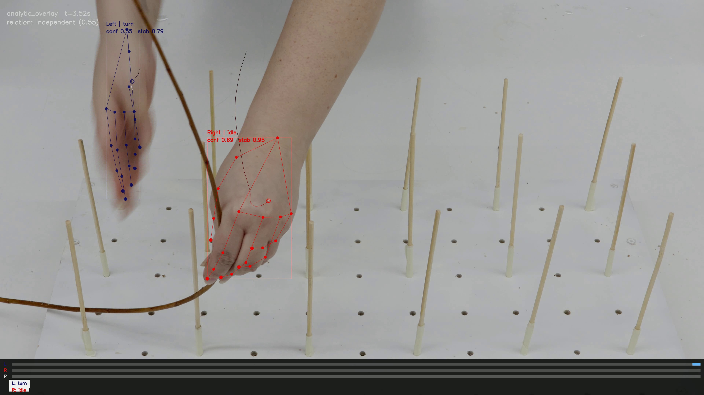
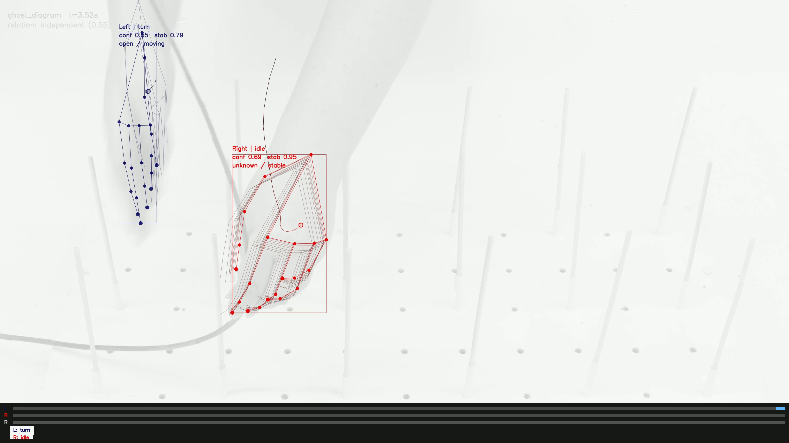
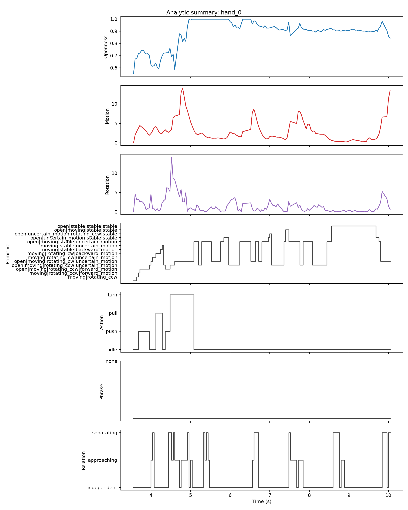
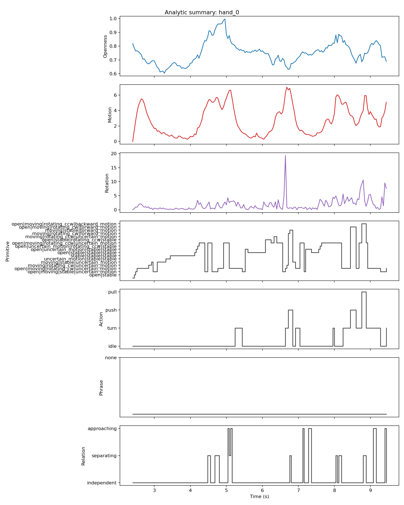
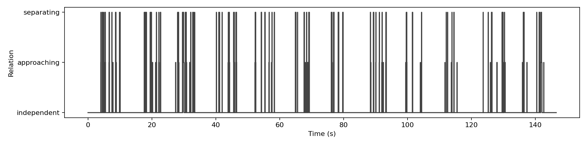

# HandTrackingSystem — Hand Motion Analysis for Handcraft

HandTrackingSystem analyzes hand posture and motion in prerecorded videos. It tracks up to two hands, assigns rule-based action labels, groups actions into time segments, checks predefined action sequences, and exports videos, tables, plots, and review reports.

**Status: working research prototype.** The processing pipeline and local review workspace are implemented. Tracking continuity and action recognition still need validation and improvement. The existing examples demonstrate the output format; they do not establish recognition accuracy.

## Index

- [Overview](#overview)
- [Demo](#demo)
- [Getting Started](#getting-started)
- [Step-by-step usage](#step-by-step-usage)
- [Defined movements and relations](#defined-movements-and-relations)
- [Output files](#output-files)
- [Review workspace](#review-workspace)
- [Reference annotations and evaluation](#reference-annotations-and-evaluation)
- [Configuration and tuning](#configuration-and-tuning)
- [Architecture](#architecture)
- [Current results and verification](#current-results-and-verification)
- [Known issues and missing capabilities](#known-issues-and-missing-capabilities)
- [Development priorities](#development-priorities)
- [Troubleshooting](#troubleshooting)
- [Authors](#authors)
- [References](#references)
- [Credits](#credits)
- [License](#license)

## Overview

This project explores how handcraft activity can be described through visible hand posture, motion, and coordination. It separates landmark tracking from interpretable action rules so that predictions can be inspected, compared, and corrected during review.

The repository uses the [MRAC-IAAC student project submission template](https://github.com/MRAC-IAAC/student-project-name). Template and structure credits are retained in [Credits](#credits). The implemented workflow is a local Python video-analysis pipeline; the template's example ROS and Docker instructions do not apply to this project.

## Demo

These are actual outputs from the existing local runs. Documentation images are kept in `docs/images/` so this README can display them without requiring the large result videos.

### Analytic overlay

The source video is overlaid with hand landmarks, bounding boxes, trajectories, action labels, tracking scores, and a compact timeline. Left-hand labels are dark blue; right-hand labels are red. These are estimated labels and may be incorrect.



*Extracted from `results/MVI_0782/annotated.mp4`, frame 88 at 25 FPS (3.52 seconds). The displayed `turn` label is a prediction, not a human-verified annotation.*

### Ghost diagram

A faded background and pose echoes emphasize hand movement. This is the same frame as the analytic example above.



*Extracted from `results/MVI_0782/ghost_diagram.mp4`.*

### Feature and action plots

The exported plots show openness, motion, rotation, primitive states, action labels, grammar matches, and inter-hand relations over time. A plot belongs to a tracking ID; a physical hand can acquire several IDs after tracking interruptions.



*Unmodified copy of `results/MVI_0772/plots/hand_0_summary.png`. The empty phrase track reflects the absence of matched high-level phrases in this run.*

<details>
<summary>Feature summary from the second example run</summary>



*Unmodified copy of `results/MVI_0782/plots/hand_0_summary.png`.*

</details>

### Inter-hand relation plot



*Unmodified copy of `results/MVI_0772/plots/relation_timeline.png`. This plot shows frame-level relation predictions; the exported relation segments also apply duration and merging rules.*

## What the system does

The project supports inspecting manual tasks, exploring hand-motion rules, reviewing uncertain detections, and preparing data for later annotation or modeling.

Implemented capabilities include:

- MediaPipe Hands detection with 21 landmarks per detected hand, up to two hands per frame.
- Temporal hand identity association, smoothing, handedness voting, and recovery after short detection gaps.
- Feature extraction for openness, finger curl, palm orientation, motion, rotation, engagement, and visibility heuristics.
- Primitive state classification, low-level action scoring, segment consolidation, and predefined action grammar.
- Inter-hand relation inference.
- Analytic and ghost video rendering, plots, CSV/JSON exports, summaries, and optional debug explanations and snapshots.
- Single-video and batch execution, scenario presets, and optional reference-based evaluation.
- A local Streamlit workspace for reading results and saving reviewer notes.

MediaPipe provides the learned landmark detector. The action, sequence, and relation layers use deterministic rules and thresholds; there is no trained action classifier in this project. Labels such as `grab`, `dual_hold`, or `handoff_like` describe patterns inferred from hand geometry. The system does not detect objects or verify contact with them.

The current entry point processes video files. Live webcam capture, sign-language recognition, and calibrated physical 3D measurements are not implemented.

## Getting Started

### Obtain the project

```powershell
git clone https://github.com/dogrultucu/Hand-Tracking-System-.git
cd Hand-Tracking-System-
```

Alternatively, download and extract the repository ZIP from GitHub, then open a terminal in the extracted directory. The repository includes source code and documentation images. Source recordings, full result videos, and the local `.venv` are excluded; run the analysis on your own video before opening the review app in a fresh checkout.

### Requirements

- Python 3.10 is the verified local baseline (the existing environment uses 3.10.11).
- A video readable by OpenCV and enough disk space for rendered outputs.
- Package installation access for the dependencies in `requirements.txt`.

The primary dependencies are OpenCV, MediaPipe **0.10.14**, NumPy, pandas, SciPy, Matplotlib, Streamlit, and Plotly. Most dependencies use minimum versions rather than a complete version lock; a fresh installation is not guaranteed to reproduce the exact local environment.

### Windows / PowerShell

Open PowerShell in the project directory. If `.venv` is already installed and working, skip environment creation and installation.

```powershell
py -3.10 -m venv .venv
.\.venv\Scripts\python.exe -m pip install --upgrade pip
.\.venv\Scripts\python.exe -m pip install -r requirements.txt
.\.venv\Scripts\python.exe -m pip check
.\.venv\Scripts\python.exe main.py --help
```

Commands below invoke the environment's Python directly, so activating the virtual environment or changing PowerShell's execution policy is unnecessary. Run them from the repository root.

On macOS/Linux, create an environment with `python3.10 -m venv .venv` and substitute `.venv/bin/python` for `.\.venv\Scripts\python.exe`. Those platforms have not been verified in this local review.

## Step-by-step usage

### 1. Prepare a source video

Use the original recording as input. Keep hands large enough to see fingers, use even lighting, limit blur and occlusion, and keep the camera fixed where practical. Camera orientation affects push/pull interpretation.

Single-file input accepts any file OpenCV can decode. Batch discovery looks for `.mp4`, `.mov`, `.avi`, `.mkv`, `.mpg`, and `.mpeg` in the selected directory. It does not recurse into subdirectories. Extension matching may be case-sensitive on other operating systems.

### 2. Check the available presets

```powershell
.\.venv\Scripts\python.exe main.py --list_presets
```

| Preset | Intended starting point |
| --- | --- |
| `default` | Baseline configuration |
| `frontal_close` | Close frontal view |
| `side_view_single_operator` | Side view of one operator |
| `side_view_two_hand_manipulation` | Two-hand manipulation from a side view |
| `high_motion_noisy_video` | Faster or noisier motion |
| `low_light_video` | Lower-light footage |

Presets change thresholds and smoothing; their names do not imply benchmarked performance. Compare their results on your footage.

### 3. Run an initial short analysis

Replace the example input with a real video path. This command analyzes the first 300 frames without rendering videos or plots:

```powershell
.\.venv\Scripts\python.exe main.py --input "O:\Videos\example.mp4" --output_dir "results\example_trial" --max_frames 300 --render_mode none --disable_plots --debug_exports
```

Start with `summary_report.md`, `evaluation_summary.json`, and `gesture_segments.csv`. Check whether hand IDs remain stable and the predicted labels match the visible movement.

**Frame-limit caveat:** `--max_frames` caps inference only. If video rendering is enabled, the renderer currently reads the whole source video. Use `--render_mode none` for a limited trial, or supply an externally trimmed clip when testing rendered output.

### 4. Run a full analysis

```powershell
.\.venv\Scripts\python.exe main.py --input "O:\Videos\example.mp4" --output_dir "results\example" --preset side_view_two_hand_manipulation --debug_exports --snapshot_exports
```

By default this produces both video modes, plots, reports, and evaluation summaries. Processing is offline and runs until completion; long or high-resolution videos can take time and produce large files.

**Output-directory rule:** with `--input`, files are written directly into `--output_dir`. Use a distinct output directory for each video or configuration. Reusing a directory overwrites matching filenames and can leave older optional outputs behind.

### 5. Open the review workspace

```powershell
.\.venv\Scripts\python.exe review_app.py --results_dir "results\example"
```

Open [http://localhost:8501](http://localhost:8501) if the browser does not open automatically. Stop the server with `Ctrl+C` in its terminal.

To browse the existing local example runs instead:

```powershell
.\.venv\Scripts\python.exe review_app.py --results_dir results
```

This existing-results command is for the original development machine or a machine where results have already been generated. Existing result folders and full videos are excluded from the source repository. The documentation images are sufficient to view the examples in this README.

### 6. Process a directory of videos

```powershell
.\.venv\Scripts\python.exe main.py --input_dir "O:\Videos" --output_dir "results\batch_01" --preset default --debug_exports
.\.venv\Scripts\python.exe review_app.py --results_dir "results\batch_01"
```

Batch mode creates one subdirectory per video stem and `batch_summary.csv` at the batch root. Files with the same stem, such as `sample.mp4` and `sample.mov`, share an output directory; give them unique names. Processing is sequential, and an unhandled error stops the batch.

### Useful command options

| Option | Behavior |
| --- | --- |
| `--render_mode both` | Both output videos; default |
| `--render_mode analytic` | Analytic overlay only |
| `--render_mode ghost` | Ghost diagram only |
| `--render_mode none` | Skip video rendering; table analysis still runs |
| `--disable_plots` | Skip Matplotlib plot generation |
| `--debug_exports` | Write debug event CSV/JSON files |
| `--snapshot_exports` | Export representative source frames; requires reports to remain enabled |
| `--no_reports` | Skip event/timeline tables, text/Markdown reports, and snapshot export |
| `--no_evaluation` | Skip writing evaluation files; evaluation calculations still run internally |
| `--max_frames N` | Limit inference to the first N frames |
| `--push_axis X Y Z` | Override the normalized motion projection axis |
| `--swap_handedness_labels` | Swap MediaPipe Left/Right labels |
| `--frame_left_maps_to Left` or `Right` | Set the horizontal prior used when two visible hands have conflicting labels |
| `--annotations PATH` | Supply a reference CSV/JSON file or matching annotation directory |

## Defined movements and relations

These tables describe rules present in the code. A defined class may never appear in a particular run. Scores are heuristic confidence values, not calibrated probabilities of correctness.

### Primitive states

| Category | States |
| --- | --- |
| Posture | `open`, `closed`, `unknown` |
| Transition | `opening`, `closing`, `neutral`, `uncertain_motion` |
| Translation | `stable`, `moving`, `uncertain_motion` |
| Rotation | `stable`, `rotating`, `rotating_cw`, `rotating_ccw`, `uncertain_motion` |
| Direction | `stable`, `forward_motion`, `backward_motion`, `uncertain_motion` |

States are stabilized across frames before downstream interpretation. Initialization can temporarily produce `unknown` values. Clockwise/counterclockwise labels reflect the image-coordinate orientation convention, not calibrated object rotation.

### Per-hand actions

| Exported label | Pattern the rule attempts to identify |
| --- | --- |
| `idle` | Fallback or highest-scoring inactive state |
| `grab` | Recent open-to-closed transition with closing activity |
| `hold` | Closed, stable posture with sufficient engagement |
| `turn` | Sustained rotation evidence |
| `push` | Forward directional motion under the configured camera assumptions |
| `pull` | Backward directional motion under the configured camera assumptions |
| `push + turn` | Overlapping push and rotation evidence |
| `pull + turn` | Overlapping pull and rotation evidence |
| `release + push` | Opening/recently closed posture combined with forward motion |
| `move + hold` | Translational motion while an engaged or closed posture persists |

One winning action is selected per visible hand per frame. Combined labels are explicit classes. There is no standalone `release` class. By default, idle segments are suppressed and very short action segments are filtered out.

### High-level action grammar

| Phrase label | Required ordered components |
| --- | --- |
| `manipulate_and_insert` | `grab` → `turn` → `push` |
| `twist_and_extract` | `grab` → `hold` → `pull + turn` |
| `reposition_and_reengage` | `release + push` → `grab` |
| `reposition_and_reengage` | `release + push` → `move + hold` → `grab` |

Grammar operates on consolidated segments for the same tracking ID. It checks component confidence, ordering, time gaps, and overlap rules. Other labels may be skipped while searching for components. Phrase names are interpretations of these patterns, not verification of insertion, extraction, or object interaction.

### Inter-hand relations

| Exported label | Intended interpretation |
| --- | --- |
| `independent` | Fallback when no stronger relation is selected, including fewer than two visible hands |
| `approaching` | Normalized distance between hands decreases |
| `separating` | Normalized distance between hands increases |
| `coordinated` | Motion vectors align with sufficient engagement |
| `mirrored_motion` | Motion vectors point in opposing directions |
| `supporting` | One hand remains stable while the other performs an active action |
| `dual_hold` | Both hands are closed, stable, and engaged |
| `handoff_like` | Nearby release/push and grab predictions occur together |

## Output files

A typical full run has this structure. Optional directories can be empty.

```text
results/example/
├── annotated.mp4
├── ghost_diagram.mp4
├── frame_features.csv
├── primitive_states.csv
├── gesture_segments.csv / .json
├── action_phrases.csv / .json
├── relation_frames.csv
├── relation_segments.csv / .json
├── event_summary.csv
├── timeline_summary.csv
├── summary_report.md / .txt
├── evaluation_summary.json
├── evaluation_metrics.csv
├── thresholds_used.json
├── run_metadata.json
├── batch_summary.csv
├── debug_events.csv / .json       # --debug_exports
├── plots/
├── snapshots/                     # --snapshot_exports
└── review_notes.csv / .json       # after saving notes in the UI
```

| Artifact | Purpose |
| --- | --- |
| `frame_features.csv` | One row per detected hand/frame: landmarks, features, primitive states, action and tracking scores |
| `primitive_states.csv` | Primitive labels and confidence details per hand/frame |
| `gesture_segments.*` | Consolidated action intervals with IDs, labels, times, confidence, and explanations |
| `action_phrases.*` | Matched high-level sequences; may be empty |
| `relation_frames.csv`, `relation_segments.*` | Frame-level and consolidated inter-hand relations |
| `event_summary.csv` | Actions linked to overlapping phrases and relations |
| `timeline_summary.csv` | Per-hand frame summary for review |
| `summary_report.*` | Human-readable overview of counts, warnings, and events |
| `evaluation_summary.json` | Descriptive statistics and, when references are supplied, evaluation summaries |
| `evaluation_metrics.csv` | Reference-based metrics; may be blank without annotations |
| `thresholds_used.json` | Effective configuration, including the selected preset and overrides |
| `run_metadata.json` | Source path, dimensions, FPS, processed frame count, profile, warnings, and output paths |
| `debug_events.*` | Decision explanations, segment filtering, grammar matches/rejections, and tracking counters |
| `snapshots/` | Representative original source frames near selected event midpoints |
| `plots/` | Per-track feature summaries and relation plots |

Times are seconds relative to the video start; frame indices begin at zero. `hand_0`, `hand_1`, etc. are temporal track IDs. They are separate from estimated `Left`/`Right` handedness. `hands_detected` in the batch summary counts unique track IDs over the run, not simultaneous hands or people.

## Review workspace

The Streamlit application reads exported artifacts. It does not launch detection or rerun inference when settings are inspected.

1. Select a run from the sidebar.
2. Select `analytic_overlay`, `ghost_diagram`, or `original` as the video source.
3. Filter tracks and labels, then use the segment selector and table to inspect events.
4. Review linked primitives, relations, explanations, snapshots, and feature signals.
5. Save a verdict (`correct`, `incorrect`, or `uncertain`), alternate label, and note when needed.
6. Select sibling runs to compare their thresholds.

Notes are written to `review_notes.csv` and `review_notes.json`. They do not modify inference output, retrain a model, or automatically become evaluation annotations.

To use another port:

```powershell
.\.venv\Scripts\python.exe review_app.py --results_dir results --server_port 8601
```

The default server address is `127.0.0.1`. `--headless` starts it without requesting a browser window. See the known issues below before relying on the interactive timeline or video synchronization.

## Reference annotations and evaluation

Without reference annotations, evaluation produces descriptive statistics only. Prediction confidence, action counts, and tracking warnings are not accuracy measurements.

To evaluate against human labels:

```powershell
.\.venv\Scripts\python.exe main.py --write_annotation_template annotation_template.csv
```

Fill in the generated CSV using this schema:

```csv
target_type,scope,label,start_frame,end_frame,start_time,end_time,confidence,notes
action,Left,grab,120,156,4.80,6.24,1.0,Human reference at 25 FPS
```

- `target_type`: `action`, `phrase`, or `relation`.
- `scope`: action track ID such as `hand_0`, or handedness such as `Left`; phrase scope should match the exported track ID; use `inter_hand` for relations (relation matching does not filter by scope).
- `label`: exact class name from the tables above.
- Supply both frame and time fields. Matching uses `start_time` and `end_time`; frame fields are not automatically converted to times.
- JSON input is a list of objects with the same fields.

Run the analysis with references:

```powershell
.\.venv\Scripts\python.exe main.py --input "O:\Videos\example.mp4" --output_dir "results\example_evaluated" --annotations annotation_template.csv
```

For batch processing, pass an annotation directory containing `<video_stem>.csv` or `<video_stem>.json`. A missing matching annotation file is silently treated as an unannotated video. An explicitly supplied missing file should be checked before execution.

The evaluator reports per-class precision, recall, F1, average matched temporal IoU, average prediction confidence, and false-positive/false-negative counts. Matching is greedy and uses configurable temporal IoU thresholds (defaults: action 0.30, phrase 0.25, relation 0.30). The confusion summary contains false-positive/false-negative counts rather than a full cross-class confusion matrix. Dense frame-level benchmarking is not implemented.

## Configuration and tuning

Defaults are dataclasses in `config.py`; scenario overrides are in `presets.py`. A run applies the selected preset and then supported command-line overrides. There is no general external configuration-file loader.

| Area | Main controls |
| --- | --- |
| Tracking | `smoothing_alpha`, `dropout_tolerance_frames`, `assignment_max_cost`, `suspected_switch_cost_threshold` |
| Features | Temporal windows, motion/posture smoothing, side-view geometry thresholds |
| Primitive states | Open/closed thresholds, motion and rotation thresholds, confirmation frames, visibility threshold |
| Actions | Minimum action confidence, engagement threshold, motion and rotation controls, push axis |
| Segments | Minimum duration in frames and merge gaps |
| Grammar | Maximum component gap and minimum phrase/component confidence |
| Relations | Distance-change, vector similarity, support, and relation confidence thresholds |
| Rendering | Fades, colors, line widths, echo length, trajectories, labels, codec |

Use distinct directories when comparing configurations and inspect the exported `thresholds_used.json`. Some rules also contain hard-coded constants; configuration coverage needs review before automated tuning.

The default push axis is `(0, 0, -1)`. For suitable side-view geometry, the current primitive rules can instead use dominant vertical image motion: downward becomes forward and upward becomes backward. These conventions require validation against the camera view and task; changing the axis alone does not override every side-view rule.

Temporal windows and duration thresholds are largely frame-based. Different FPS values can change behavior even for similar physical movements.

## Architecture

```text
Video frames
    → MediaPipe detection + temporal tracking
    → Per-hand feature extraction
    → Primitive state stabilization
    → Low-level action scoring ──────┐
    → Inter-hand relation scoring    │
    → Action/relation consolidation ←┘
    → High-level grammar on action segments
    → Evaluation, reports, plots, and video rendering
    → Streamlit review + reviewer notes
```

| Module | Responsibility |
| --- | --- |
| `main.py` | CLI, configuration, and processing orchestration |
| `tracker.py` | Detection, track association, smoothing, handedness stabilization |
| `features.py`, `primitives.py` | Geometric/temporal features and primitive states |
| `gestures.py` | Per-hand low-level action scores and explanations |
| `relations.py` | Frame-level inter-hand relations |
| `segments.py` | Duration filtering and segment merging |
| `grammar.py` | Predefined action-sequence matching |
| `visualization.py` | Analytic/ghost rendering and diagnostic plots |
| `config.py`, `presets.py` | Defaults, scenario profiles, configuration export |
| `annotations.py`, `evaluation.py` | Reference import and segment metrics |
| `debug_tools.py`, `reporting.py` | Explanations, summaries, reports, snapshots |
| `batch_runner.py`, `io_utils.py` | Input discovery and artifact writing |
| `review_app.py`, `review_ui.py` | Review server launcher and page orchestration |
| `ui_state.py`, `ui_timeline.py`, `ui_components.py` | Artifact loading, timeline construction, review panels |

## Current results and verification

The existing local runs were generated in March 2026 with the `default` profile. They are historical outputs and have not been regenerated as a benchmark against the current code.

| Measure | MVI_0772 | MVI_0782 |
| --- | ---: | ---: |
| Duration | 146.56 s | 82.44 s |
| Processed frames | 3,664 | 2,061 |
| Source format | 3840 × 2160, 25 FPS | 3840 × 2160, 25 FPS |
| Unique track IDs | 84 | 32 |
| Suspected identity-switch counter | 127 | 50 |
| Primitive uncertain frequency | 74.84% | 72.17% |
| Action segments | 53 turn, 10 push, 7 pull | 30 turn, 5 push, 3 pull |
| Matched grammar phrases | 0 | 0 |
| Human reference annotations | None | None |

Sources: each run's `run_metadata.json` and `evaluation_summary.json` under `results/`.

The large number of track IDs indicates interrupted tracking, not dozens of different hands. Suspected-switch counts are diagnostic heuristics, not confirmed identity errors. The uncertain frequency is a primitive-label statistic, not an error rate. Frequent track interruptions and missing action components can prevent grammar matches.

Local checks performed on 2026-11-24:

- Syntax parsing passed for all 22 Python modules.
- Dependency and project imports passed; `pip check` reported no broken requirements.
- Preset listing executed successfully.
- Streamlit's application test loaded the existing review data with no unhandled application exceptions, while emitting compatibility/type-conversion warnings.
- A 40-frame, 1280 × 720 clip derived from an existing annotated video completed processing, detected two track IDs, and produced both rendered video modes and analysis artifacts. This checks execution only: the input already contained overlays and was not used to measure recognition accuracy.

The checked environment used Python 3.10.11, OpenCV 4.13.0, and MediaPipe 0.10.14. There is no committed automated regression-test suite or CI configuration in the current project folder.

## Known issues and missing capabilities

| Area | Current limitation and practical effect |
| --- | --- |
| Review timeline | `ui_timeline.py` passes numeric seconds to Plotly's date-based timeline. A reproduced 1.2–2.4 s interval had zero bar width. Use segment tables, exported plots, and CSV times until this is fixed. |
| Video synchronization | Selecting a segment or inspection time does not seek the video player. Seek manually using the displayed times. |
| Tracking | Occlusion, blur, crossed hands, and detector failures can fragment one physical hand into many IDs and interrupt sequences. |
| Recognition | Threshold-based labels are camera/task dependent. Scores are not calibrated probabilities; no validated accuracy is available for the example runs. |
| Object interaction | No object detector, contact verification, or semantic validation of holding, insertion, extraction, or handoff is implemented. |
| Original recordings | Both historical runs point to files under `O:\Downloads` that were absent during the local review. Their original-video UI source is unavailable until the recordings are restored or metadata paths updated. |
| Frame cap | `--max_frames` limits inference, but video rendering still traverses the complete input. |
| Empty artifacts | Some empty CSV exports have no header; the review loader uses `pandas.read_csv` without empty-file handling. Runs with no detected hands can therefore fail to load. |
| Review dependencies | Streamlit emits deprecated `use_container_width` warnings and automatically repairs mixed-type threshold tables. These need compatibility cleanup. |
| Playback | Default video encoding is `mp4v`; browser codec support varies. A video may play in a desktop player but fail in the embedded browser. |
| Batch robustness | No per-video failure recovery or resume mechanism; duplicate stems can overwrite results. |
| Reproducibility | Most dependencies are not pinned, references are not bundled, and there is no automated regression suite or benchmark dataset. |
| Distribution | Source code and documentation images are versioned. Full recordings/results and the Python environment are excluded by `.gitignore`; recreate the environment and generate results locally. The inherited MIT license and template acknowledgements are retained. |

## Development priorities

The following items are proposed work, not completed features:

1. **Repair review correctness:** use a seconds-based timeline, handle empty exports, improve codec compatibility, and synchronize video seeking with selected events.
2. **Improve tracking continuity:** inspect dropout cases, identity association, handedness conflicts, and long interruptions using representative videos.
3. **Establish a measured baseline:** annotate short clips for all intended classes, calculate segment metrics, and separate tuning clips from validation clips.
4. **Validate action rules:** address camera dependence, frame-rate sensitivity, hard-coded constants, and the lack of grammar matches in existing examples.
5. **Harden execution:** honor frame limits during rendering, isolate batch failures, avoid output collisions, and add useful progress reporting.
6. **Make development reproducible:** lock a verified environment, provide representative validation data where distribution is permitted, and add focused regression checks and CI. Version control, ignore rules, and the inherited license are already in place.
7. **Extend after validation:** consider richer annotation workflows, threshold sweeps, object context, or supervised temporal models based on measured needs.

## Troubleshooting

| Symptom | What to check or do |
| --- | --- |
| `ModuleNotFoundError` | Use the `.venv` Python shown above and install `requirements.txt` into that environment. |
| Missing `mediapipe.solutions` | Confirm the installed version matches the project's `mediapipe==0.10.14` requirement. |
| Cannot open a video | Confirm the full path exists and OpenCV can decode the file. Quote paths containing spaces. |
| No videos discovered | Check the selected directory, supported extensions, and that inputs are directly inside it. |
| Mostly idle/uncertain labels | Inspect visibility, hand size, blur, occlusion, handedness, preset, and the push/pull convention before adjusting thresholds. |
| No grammar phrases | Check for the required action labels on the same track ID, sufficient confidence, and acceptable gaps. |
| Incorrect Left/Right labels | Inspect the source orientation; try `--swap_handedness_labels` or adjust the conflict prior with `--frame_left_maps_to`. |
| Blank review timeline | This is a known timeline implementation issue; inspect the segment table and exported plots. |
| Original video missing in review | Restore the source file or correct `input_video_path` in that run's metadata. |
| Video fails only in browser | Try a desktop player; produce a browser-compatible H.264 copy with an external encoder if needed. |
| Port already in use | Pass `--server_port 8601` and open `http://localhost:8601`. |
| Review crashes on an empty run | Check CSV files for missing headers; empty-run loading needs a code fix. |
| Unexpected files from an earlier run | Choose a fresh output directory; disabling an export does not remove a previous copy. |

For the complete current CLI reference, run:

```powershell
.\.venv\Scripts\python.exe main.py --help
.\.venv\Scripts\python.exe review_app.py --help
```

## Authors

- [dogrultucu](https://github.com/dogrultucu) — hand-motion analysis project and repository maintainer.

## References

The implementation uses these projects and libraries:

- [MediaPipe](https://github.com/google-ai-edge/mediapipe) — hand landmark detection; this project pins version 0.10.14 and uses its Hands solution API.
- [OpenCV](https://opencv.org/) — video decoding, image processing, and rendered video output.
- [NumPy](https://numpy.org/), [pandas](https://pandas.pydata.org/), and [SciPy](https://scipy.org/) — numerical operations and data processing.
- [Matplotlib](https://matplotlib.org/) — exported diagnostic plots.
- [Streamlit](https://streamlit.io/) and [Plotly](https://plotly.com/python/) — local review workspace and interactive charts.

## Credits

Repository layout adapted from the [MRAC-IAAC Group Project Repository Submission Template](https://github.com/MRAC-IAAC/student-project-name). The original template acknowledgements are preserved below. These credits concern the template and repository structure; project implementation is listed under Authors.

<!-- DO NOT REMOVE: original template acknowledgements -->
#### Acknowledgements

- Creation of GitHub template: [Marita Georganta](https://www.linkedin.com/in/marita-georganta/) - Robotic Sensing Expert
- Creation of MRAC-IAAC GitHub Structure: [Huanyu Li](https://www.linkedin.com/in/huanyu-li-457590268/) - Robotic Researcher

## License

See [LICENSE](LICENSE) for the MIT license inherited from the repository template. Its original copyright notice is retained. Third-party dependencies remain subject to their respective licenses.
